  

# 🎬 Awesome Video Hosting & Video Marketing

  
  
  
  
  
  
  

> 🌟 A curated directory and market breakdown of leading **Enterprise Video Hosting**, **Video Marketing Platforms**, **Conversion-Driven Video Players**, and **Open-Source Video CMS & Streaming Infrastructure**.

Discover the best SaaS tools and self-hosted open-source software to upload, transcode, embed, stream, monetize, and analyze high-converting video content across web, mobile, and CRM workflows.

---

## 📊 Sector Overview & Market Dynamics

The global enterprise video hosting and Online Video Platform (OVP) market is estimated between **$1.5B and $6.0B+** (scaling past **$15B+** by 2030), while digital video advertising and video marketing expenditure exceeds **$250B+** worldwide. The video hosting and marketing landscape is **moderately fragmented**: commodity public hosting and broadcast CDN streaming exhibit high concentration, but the B2B marketing, sales enablement, and enterprise video CMS segments remain highly competitive, with specialized vendors carving out defensible moats across CRM lead-gating, interactive AI-avatar generation, privacy-first compliance, and self-hosted infrastructure.

---

## 📑 Table of Contents

- [📊 Sector Overview & Market Dynamics](#-sector-overview--market-dynamics)
- [☁️ SaaS Video Hosting & Marketing Platforms](#️-saas-video-hosting--marketing-platforms)
- [🔓 Open-Source Video Hosting & Streaming Infrastructure](#-open-source-video-hosting--streaming-infrastructure)
  - [🏆 Community Star Rankings](#-community-star-rankings)
  - [⚙️ Self-Hosted Platforms & Transcoding Engines](#️-self-hosted-platforms--transcoding-engines)
  - [🏢 Enterprise Video CMS & Portal Systems](#-enterprise-video-cms--portal-systems)
  - [📡 Media Streaming & Real-Time Broadcast Infrastructure](#-media-streaming--real-time-broadcast-infrastructure)
- [⚖️ Feature & Architectural Comparison Matrix](#️-feature--architectural-comparison-matrix)
- [🧭 How to Choose the Right Solution](#-how-to-choose-the-right-solution)
- [🤝 How to Contribute](#-how-to-contribute)
- [⭐ Star History](#-star-history)
- [💖 Support](#-support)
- [📜 License & Disclaimer](#-license--disclaimer)

---

## ☁️ SaaS Video Hosting & Marketing Platforms

The table below lists the premier video hosting and video marketing SaaS solutions, sorted in descending order by company scale (market capitalization or valuation / annual recurring revenue).

| Platform | Market Valuation / Scale | Starting Pricing | Free Tier Limits / Trial Limits | Key Marketing & Hosting Strengths |
| :--- | :--- | :--- | :--- | :--- |
| **[HubSpot Video Hosting](https://www.hubspot.com/)** | **~$25B–$30B Market Cap** (~$3.1B+ ARR) | Included in paid Hubs (Content Hub Starter at **$15/seat/mo**) | **Free Forever Tier**: Basic video hosting & embedding across CRM pages, blogs, and emails; limited to basic player styling with HubSpot branding and no automated CTA lead triggers | Native CRM contact synchronization, inline viewer attribution, and automated workflow triggers. |
| **[Synthesia](https://www.synthesia.io/)** | **$4.0B Valuation** (~$115M+ ARR) | **$29/mo** (billed monthly) or **$18/mo** (billed annually) for Starter | **Free Forever Tier**: 3 minutes of video generation per month, 9 stock AI avatars, watermarked MP4 exports, no custom avatar training | Generative AI text-to-video studio with 160+ photorealistic avatars and multi-language voice dubbing. |
| **[Vimeo](https://vimeo.com/)** | **$1.38B Valuation** (Acquired by Bending Spoons; ~$410M ARR) | **$13/seat/mo** (billed annually) or **$20/mo** (billed monthly) for Starter | **Free Forever Tier**: Unlimited public video uploads, but non-public/embed storage strictly capped at **3 GB total**, standard Vimeo watermark, basic analytics | High-definition ad-free playback, portfolio showcases, review workspaces, and social video publishing. |
| **[Loom](https://www.loom.com/)** | **$975M Valuation** (Acquired by Atlassian; ~$50M ARR) | **$15/user/mo** (billed annually) or **$18/user/mo** (billed monthly) for Business | **Free Forever Tier**: Up to **25 videos total per creator**, maximum **5 minutes recording length**, 720p resolution cap, up to 50 workspace creators | Rapid asynchronous screen/webcam recording, AI transcript auto-editing, auto-summaries, and Atlassian ecosystem sync. |
| **[Brightcove](https://www.brightcove.com/)** | **~$200M Market Cap** (NASDAQ: BCOV; ~$205M ARR) | **Custom Enterprise Quotes** (Standard annual commitments typically start at **$499/mo** / ~$5,000–$15,000/year) | **30-Day Free Trial**: Full-featured enterprise trial capped at **5 video uploads** and restricted bandwidth for proof-of-concept testing | Enterprise OTT streaming, carrier-grade CDN distribution, server-side ad insertion (SSAI), and broadcast analytics. |
| **[Wistia](https://wistia.com/)** | **Bootstrapped / Private** (~$50M–$67M ARR) | **$79/mo** (billed annually) or **$99/mo** (billed monthly) for Business | **Free Forever Tier**: Limited to **1 user**, **25 GB storage**, **200 GB monthly bandwidth**, Wistia branding on player, basic analytics | Built specifically for marketers: Turnstile lead capture, video heatmaps, custom CTA gates, and HubSpot/Salesforce sync. |
| **[Vidyard](https://www.vidyard.com/)** | **~$90M VC Funded / Private** (~$35M–$45M ARR) | **$59/user/mo** (billed annually) or **$89/user/mo** (billed monthly) for Starter | **Free Forever Tier**: **5 video recordings per month**, maximum **30 minutes per video**, basic sharing pages, standard Vidyard branding | Video selling and SDR prospecting: personalized video emails, AI script generation, view notifications, and CRM pipeline attribution. |
| **[Hippo Video](https://www.hippovideo.io/)** | **~$15M+ Venture Funded / Private** (~$10M–$15M ARR) | **$20/user/mo** (billed annually) or **$30/user/mo** (billed monthly) for Pro | **Free Forever Tier**: Up to **50 videos recorded per month** (30-minute recording limit), 2 video flows, 2 sales landing pages, 10 min closed captions | Interactive video outreach, customized sales landing pages, teleprompter, and multichannel sales outreach sequences. |
| **[Cincopa](https://www.cincopa.com/)** | **Bootstrapped / Private** (~$5M–$10M ARR) | **$90/mo** for Starter tier (Annual billing) | **Free Forever Tier**: Limited to **400 MB total storage**, **100 MB max file size**, restrictive bandwidth; plus **14-day full trial** of paid tiers | Rich media CMS supporting video playlists, multi-media galleries, podcasts, video courses, and VideoGPT search. |
| **[SproutVideo](https://sproutvideo.com/)** | **Bootstrapped / Private** (~$5M–$8M ARR) | **$10/mo** (Seed plan; billed annually or monthly with usage tiers) | **30-Day Free Trial**: Access to Forest-tier features, capped at **5 GB storage**, **5 GB bandwidth**, 15 live stream input mins, 3 encoding slots | Privacy-focused business video hosting: password protection, geo-restriction, IP whitelisting, and integrated lead-capture forms. |

---

## 🔓 Open-Source Video Hosting & Streaming Infrastructure

A curated directory of open-source video infrastructure projects, media servers, and players. Repositories are sorted in **descending order by GitHub star count**.

### 🏆 Community Star Rankings

| Project | GitHub Stars | Category & Architecture | License | Description |
| :--- | :--- | :--- | :--- | :--- |
| **[Jellyfin](https://github.com/jellyfin/jellyfin)** |  | Self-Hosted Media Server (.NET / Vue) | GPL-3.0 | 100% free software media system providing self-hosted video streaming, hardware acceleration (VAAPI, NVENC), and multi-client playback without tracking. |
| **[Video.js](https://github.com/videojs/video.js)** |  | HTML5 Video Player & SDK (JavaScript) | Apache-2.0 | World-leading embeddable web video player framework supporting HLS, DASH, customized UI skins, CTA overlays, analytics hooks, and plugins. |
| **[SRS (Simple Realtime Server)](https://github.com/ossrs/srs)** |  | High-Performance Video Cluster (C++) | MIT | Ultra-efficient RTMP/HLS/WebRTC/SRT video streaming cluster engine designed for low-latency live streaming, CDN edge delivery, and WebRTC bridges. |
| **[MediaMTX](https://github.com/bluenviron/mediamtx)** |  | Zero-Dependency Media Server (Go) | MIT | High-performance, multi-protocol video routing server ready out of the box with zero dependencies. Ingests and proxies RTSP, RTMP, HLS, WebRTC, and SRT. |
| **[PeerTube](https://github.com/Chocobozzz/PeerTube)** |  | Federated Video CMS & P2P (Node.js/TypeScript) | AGPL-3.0 | Decentralized, ActivityPub-federated alternative to YouTube/Vimeo. Reduces bandwidth costs using peer-to-peer WebTorrent/WebRTC distribution. |
| **[Owncast](https://github.com/owncast/owncast)** |  | Self-Hosted Live Streaming (Go/React) | MIT | Standalone, self-hosted live video and interactive chat server. Works with OBS Studio, streams over adaptive HLS, and federates with the Fediverse. |
| **[Restreamer](https://github.com/datarhei/restreamer)** |  | Live Video Streaming & Restreaming (Go/Node) | GPL-3.0 | Smart live video streaming server. Easily ingest video streams and broadcast simultaneously to YouTube, Twitch, Facebook, and custom HLS landing pages. |
| **[MediaCMS](https://github.com/mediacms-io/mediacms)** |  | Enterprise Video CMS (Django / React) | AGPL-3.0 | Full-featured YouTube-like video portal CMS. Supports automated FFmpeg HLS transcoding profiles (240p–1080p), Whisper AI transcription, and REST API. |
| **[Ant Media Server](https://github.com/ant-media/Ant-Media-Server)** |  | Ultra-Low Latency Streaming (Java/C++) | Apache-2.0 | Scalable streaming engine providing WebRTC streaming with sub-0.5s latency, adaptive bitrate transcoding, and RTMP ingestion. |
| **[AVideo (YouPHPTube)](https://github.com/WWBN/AVideo)** |  | Video Audio Platform & Paywall (PHP) | GPL-3.0 | Open-source enterprise audio and video streaming portal with subscription billing, pay-per-view monetization, encoders, and live streaming tools. |
| **[Opencast](https://github.com/opencast/opencast)** |  | Academic & Enterprise Lecture Capture (Java) | ECL-2.0 | Enterprise-scale video management and capture system for educational institutions and corporate training with scheduling and LMS integrations. |
| **[Mux Elements](https://github.com/muxinc/elements)** |  | Modern Web Components for Video (JS/HTML5) | MIT | Drop-in custom web components (`<mux-video>`, `<mux-player>`) delivering responsive, accessible video playback with built-in analytics hooks. |
| **[Hovod](https://github.com/Synapsr/Hovod)** |  | All-in-One Mux Alternative (Node/React) | MIT | Single-container video platform. Automatic multi-bitrate HLS transcoding, S3 storage, built-in analytics, and Whisper AI transcription. |
| **[CinemataCMS](https://github.com/EngageMedia-video/cinematacms)** |  | Privacy & Human Rights Video CMS (Python) | AGPL-3.0 | Security-audited (OTF) video CMS for civic media, advocacy archives, and documentaries with hardened access controls and MFA. |
| **[Mave Core](https://github.com/maveio/core)** |  | Self-Hosted Video Infrastructure (Go/ClickHouse) | AGPL-3.0 | Self-hosted video cloud backend. Offers DAG-based FFmpeg transcoding, S3/MinIO storage, embed players, and ClickHouse analytics for view drop-off tracking. |
| **[Vidalytics](https://github.com/vidalytics/Vidalytics)** |  | Conversion & Marketing Video Player | MIT / Mixed | Marketing-optimized video player repository designed for tracking play rates, viewer retention curves, CTA button clicks, and funnel attribution. |

---

### ⚙️ Self-Hosted Platforms & Transcoding Engines
- **[Mave Core](https://github.com/maveio/core)**: Complete video infrastructure platform. Ingests via resumable uploads, transcodes via FFmpeg DAG pipelines into adaptive HLS, stores assets on S3/MinIO, and streams playback metrics directly into ClickHouse for deep retention and drop-off analytics.
- **[Hovod](https://github.com/Synapsr/Hovod)**: The fastest deployment path for a modern self-hosted video portal in a single container. Features hardware-accelerated transcoding (360p–4K), S3 sync, Whisper AI automated subtitles, tenant team administration, and optional Stripe monetization.

### 🏢 Enterprise Video CMS & Portal Systems
- **[MediaCMS](https://github.com/mediacms-io/mediacms)**: Built with Django and React, MediaCMS is ideal for organizations building private corporate portals or university video repositories. Includes multi-profile HLS encoding, Whisper speech-to-text, and clean REST APIs.
- **[PeerTube](https://github.com/Chocobozzz/PeerTube)**: Decentralized, ActivityPub-federated platform by Framasoft. Leverages browser-to-browser P2P streaming (WebRTC) to distribute delivery load across viewers during peak traffic events.
- **[AVideo](https://github.com/WWBN/AVideo)**: Mature, community-driven platform providing ready-to-use pay-per-view, subscription gating, and user live-broadcasting modules.
- **[CinemataCMS](https://github.com/EngageMedia-video/cinematacms)**: Privacy-hardened, OTF-audited video CMS designed for human rights organizations, sensitive documentaries, and secure community film archives.

### 📡 Media Streaming & Real-Time Broadcast Infrastructure
- **[SRS (Simple Realtime Server)](https://github.com/ossrs/srs)**: Industry-standard C++ real-time streaming server cluster powering live video ingest and low-latency delivery over WebRTC, SRT, and RTMP.
- **[MediaMTX](https://github.com/bluenviron/mediamtx)**: Lightweight Go-based media router that seamlessly transcodes and routes video feeds between surveillance cameras, broadcast systems, and web viewers.
- **[Owncast](https://github.com/owncast/owncast)**: Empowering creators to broadcast independent live streams directly to their audience with built-in chat and Fediverse integration.
- **[Restreamer](https://github.com/datarhei/restreamer)**: Ingests video from RTMP, HLS, or RTSP sources and distributes simultaneously to multiple streaming networks and self-hosted landing pages.

---

## ⚖️ Feature & Architectural Comparison Matrix

| Use Case | Best Suited Solution | Primary Trade-Off |
| :--- | :--- | :--- |
| **Inbound Marketing & Lead Generation** | **Wistia** or **HubSpot Video** | Commercial subscription cost; closed-source ecosystem. |
| **Sales Enablement & Video Prospecting** | **Vidyard** or **Loom** | User-seat pricing models; restrictive free-tier recording caps. |
| **AI Avatar Generation & Automated Training**| **Synthesia** | Minute-based credit consumption; generation processing delays. |
| **Self-Hosted Mux Alternative (Infrastructure)**| **Mave Core** or **Hovod** | Requires DevOps management for S3 storage, compute, and transcoding. |
| **Internal Company / Community Video Portal** | **MediaCMS** or **PeerTube** | Lacks out-of-the-box CRM turnstile integrations. |
| **Custom Player UI & Front-End Embedding** | **Video.js** or **Mux Elements** | Requires custom video hosting and CDN streaming backend. |
| **High-Throughput Low-Latency Live Streaming** | **SRS** or **MediaMTX** | Requires custom front-end player and API orchestration. |

---

## 🧭 How to Choose the Right Solution

1. **Do you need native CRM lead conversion?**  
   If your primary metric is pipeline revenue, choose **Wistia** or **HubSpot Video Hosting** for turnstile email gates, automated lead scoring, and CRM contact timelines.
2. **Do your sales reps need rapid asynchronous outreach?**  
   Choose **Vidyard** or **Loom** for instant webcam/screen capture, animated thumbnail generation, and instant viewing alerts.
3. **Are you building a custom video application or SaaS?**  
   Deploy **Mave Core** or **Hovod** for self-hosted transcoding and storage, or integrate **Video.js** with an S3 + CDN storage bucket for complete control over customer data and branding.
4. **Is data privacy, compliance, or self-sovereignty mandatory?**  
   Deploy **MediaCMS**, **PeerTube**, or **CinemataCMS** on private cloud infrastructure to guarantee zero tracking, HIPAA/GDPR isolation, and full ownership of intellectual property.

---

## 🤝 How to Contribute

Contributions are warmly welcomed! Help keep this directory current, accurate, and comprehensive:

1. Fork this repository.
2. Create your branch: `git checkout -b feature/add-new-platform`.
3. Add the SaaS tool or open-source repo with accurate pricing, community star badges, and factual descriptions.
4. Commit your changes: `git commit -m 'Add [Tool Name] to video ecosystem'`.
5. Push to the branch: `git push origin feature/add-new-platform`.
6. Open a Pull Request detailing the benefits and relevance of your addition.

---

## ⭐ Star History

---

## 💖 Support

If you find this curated ecosystem directory helpful for your video architecture or marketing stack:

- ⭐ **Star this repository** to show your appreciation and help others discover it.
- 🍴 **Fork and contribute** by submitting new tools, benchmarks, and updates.
- 📢 **Share with colleagues** across LinkedIn, X (Twitter), and developer communities.
- ☕ **Sponsor or buy a coffee**: Support ongoing curation and open-source directory maintenance on the [GitHub Sponsor Dashboard](https://github.com/sponsors/ishandutta2007).

---

## 📜 License & Disclaimer

- **License**: Content is released under the [Creative Commons Attribution 4.0 International (CC BY 4.0)](LICENSE) license.
- **Disclaimer**: All product names, logos, and brands are property of their respective owners. Pricing models, free tier quotas, and corporate valuations reflect market data as of late 2026 and are subject to change by their respective vendors.
